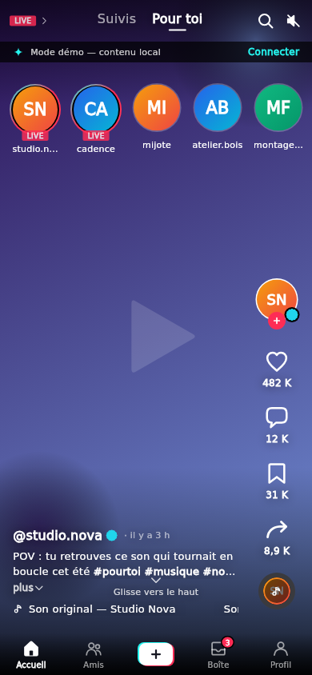
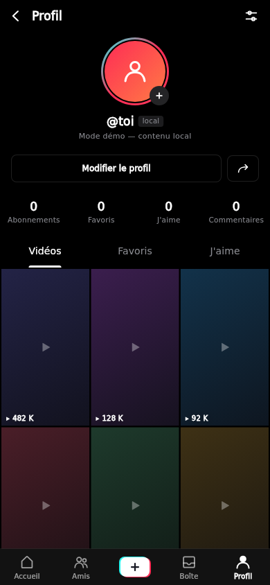

# Reel

**UI de feed vertical pour le SDK Watchtower** — feed, recherche, directs, amis, boîte de réception et profil, dans une interface sombre inspirée des feeds vidéo modernes.

[](https://github.com/ferelking242/reel/actions/workflows/ci.yml)
[](https://github.com/ferelking242/reel/actions/workflows/build-apk.yml)
[](https://github.com/ferelking242/reel/actions/workflows/build-ipa.yml)

## Aperçu

| Feed | Recherche | Profil |
|---|---|---|
|  |  |  |

| Boîte de réception | Amis | Direct |
|---|---|---|
|  |  |  |

Ces captures sont générées par `flutter test test/tools/screenshots.dart --update-goldens`
et servent de référence visuelle.

## Ce que fait l'app

- **Feed vertical** : lecture plein écran, double-tap pour aimer, barre de progression,
  glisser vers le haut pour la vidéo suivante, mise en pause au changement d'onglet.
- **Recherche** : historique local, suggestions de créateurs et de hashtags, filtres
  (type de contenu, tri, période) et résultats paginés.
- **Direct** : mise en page prête, alimentée par les créateurs du feed. L'API
  Watchtower n'expose pas encore de flux live — l'écran l'indique clairement.
- **Amis** : créateurs du feed, suggestions et abonnements, recherche locale.
- **Boîte de réception** : activité réelle (likes, favoris, abonnements, commentaires)
  plus messages système, avec compteur non-lu persistant.
- **Profil** : grille des vidéos, favoris et likes, réglages (démo, son, effacement des
  données locales, serveur).
- **Premier lancement** : sans serveur configuré, l'app ouvre le mode démo pour que
  l'interface ne soit jamais vide. Un bandeau mène à l'écran de connexion.

## Architecture

```
lib/
├── main.dart / app.dart / shell.dart / splash_screen.dart
├── core/
│   ├── icons/reel_icons.dart     ← Jeu d'icônes vectorielles maison
│   ├── theme/tokens.dart         ← Couleurs, espacements, durées, courbes
│   ├── utils/formatters.dart     ← Compteurs, dates relatives, tailles
│   └── widgets/                  ← Avatar, bouton suivre, feuilles, nav, skeletons
├── features/
│   ├── feed/                     ← PageView, overlay, sidebar, commentaires, partage
│   ├── search/                   ← Historique, suggestions, filtres, résultats
│   ├── live/                     ← Aperçu des directs
│   ├── inbox/                    ← Activité et messages système
│   ├── profile/                  ← Profil, grilles, réglages
│   ├── friends/                  ← Suggestions et abonnements
│   └── connect/                  ← Configuration du serveur Watchtower
├── remote/                       ← Client HTTP, config serveur, version
├── router/router.dart            ← Navigation (go_router)
└── utils/log/                    ← Logger fichier
```

## Prérequis

- Flutter `3.38.x` (Dart `^3.10.0`)
- Serveur [Watchtower](https://github.com/ferelking242/watchtower) (optionnel : le mode
  démo fonctionne sans serveur)
- iOS : TrollStore pour installer sans signature

## Build local

```bash
flutter pub get
flutter build apk --release --target-platform android-arm64 --split-per-abi
# iOS :
flutter build ios --release --no-codesign
```

## Tests

```bash
flutter analyze lib test
flutter test
```

`test/tools/screenshots.dart` régénère les captures de référence :

```bash
flutter test test/tools/screenshots.dart --update-goldens
```

## Télécharger

| Plateforme | Lien |
|---|---|
| **Android APK** (arm64) | [Actions → Build APK](https://github.com/ferelking242/reel/actions/workflows/build-apk.yml) |
| **iOS IPA** (TrollStore) | [Actions → Build IPA](https://github.com/ferelking242/reel/actions/workflows/build-ipa.yml) |
