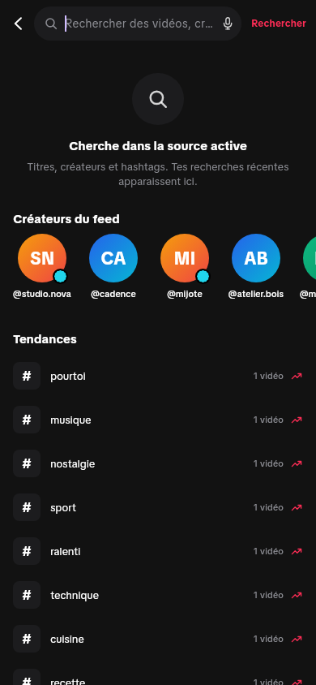
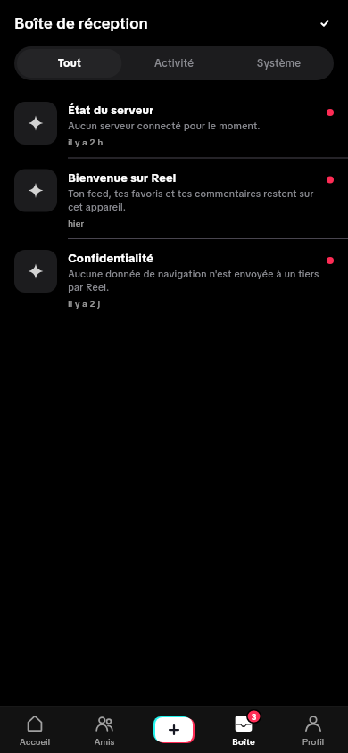
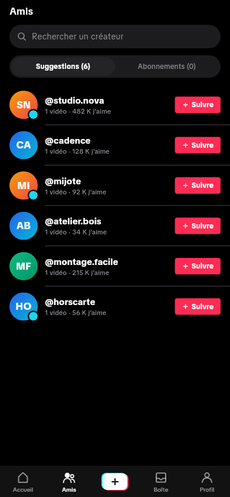
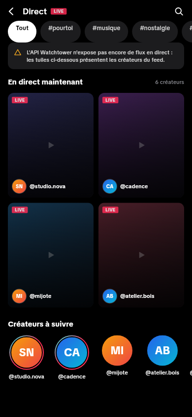

# Reel

**UI de feed vertical pour le SDK Watchtower** — feed, recherche, directs, amis, boîte de réception et profil, dans une interface sombre inspirée des feeds vidéo modernes.

[](https://github.com/ferelking242/reel/actions/workflows/ci.yml)
[](https://github.com/ferelking242/reel/actions/workflows/build-apk.yml)
[](https://github.com/ferelking242/reel/actions/workflows/build-ipa.yml)

## Aperçu

| Feed | Recherche | Profil |
|---|---|---|
|  |  |  |

| Boîte de réception | Amis | Direct |
|---|---|---|
|  |  |  |

Ces captures sont générées par `flutter test test/tools/screenshots.dart --update-goldens`
et servent de référence visuelle.

## Ce que fait l'app

- **Feed vertical** : lecture plein écran, double-tap pour aimer, barre de progression,
  glisser vers le haut pour la vidéo suivante, mise en pause au changement d'onglet.
- **Recherche** : historique local, suggestions de créateurs et de hashtags, filtres
  (type de contenu, tri, période) et résultats paginés.
- **Direct** : mise en page prête, alimentée par les créateurs du feed. L'API
  Watchtower n'expose pas encore de flux live — l'écran l'indique clairement.
- **Amis** : créateurs du feed, suggestions et abonnements, recherche locale.
- **Boîte de réception** : activité réelle (likes, favoris, abonnements, commentaires)
  plus messages système, avec compteur non-lu persistant.
- **Profil** : avatar, bio, la triade TikTok (abonnements, abonnés, j'aime), onglets
  vidéos / favoris / j'aime et réglages (son, effacement des données locales, serveur).
- **Aucune donnée factice** : l'app ne contient plus de mode démo ni de jeu de
  démonstration. Sans serveur, chaque écran affiche un état vide explicite qui mène
  à l'écran de connexion ; la recherche s'appuie sur les vidéos déjà chargées.

## Architecture

```
lib/
├── main.dart / app.dart / shell.dart / splash_screen.dart
├── core/
│   ├── contract/                 ← Contrat d'interface (dock, écrans, lecteur)
│   ├── icons/reel_icons.dart     ← Jeu d'icônes vectorielles maison (grille 24 dp)
│   ├── theme/tokens.dart         ← Couleurs, espacements, durées, courbes
│   ├── utils/formatters.dart     ← Compteurs, dates relatives, tailles
│   └── widgets/                  ← Avatar, bouton suivre, feuilles, nav, skeletons
├── features/
│   ├── feed/                     ← PageView, overlay, sidebar, commentaires, partage
│   ├── search/                   ← Historique, suggestions, filtres, résultats
│   ├── live/                     ← Aperçu des directs
│   ├── inbox/                    ← Activité et messages système
│   ├── profile/                  ← Profil, grilles, réglages
│   ├── friends/                  ← Suggestions et abonnements
│   └── connect/                  ← Configuration du serveur Watchtower
├── remote/                       ← Client HTTP, config serveur, version
├── router/router.dart            ← Navigation (go_router)
└── utils/log/                    ← Logger fichier
```

### Contrat d'interface

`assets/contract.json` décrit l'interface comme le font les `ui-layouts/*.json` de
[watchtower-extensions](https://github.com/ferelking242/watchtower-extensions), avec
deux sections supplémentaires : le shell (dock) et le lecteur.

```jsonc
{
  "schemaVersion": 1,
  "shell": {
    "dock": {
      "enabled": true,
      "type": "bar",              // bar | centered | floating | edgeToEdge
      "labels": "icon+label",     // icon | icon+label
      "activeIndicator": "fill",  // fill | dot | underline | none
      "elevation": "border",      // none | border | shadow | blur
      "height": 52, "margin": 16, "cornerRadius": 999,
      "haptics": true, "transparentOnFeed": true,
      "items": [{ "id": "home", "label": "Accueil", "icon": "home", "route": "/" }]
    }
  },
  "screens": { "feed": { }, "search": { }, "live": { }, "profile": { } },
  "player": { "mode": "feed" }
}
```

`lib/core/contract/` charge le fichier et retombe sur `UiContract.fallback` s'il est
absent ou invalide : le dock, ses libellés, son indicateur actif et ses haptiques sont
donc pilotés par le contrat sans risque de démarrage cassé. Un test
(`test/contract_test.dart`) vérifie le fichier livré et le rendu des variantes.

### Typographie

L'interface utilise **TikTok Sans**, la police officielle de TikTok publiée sous
[SIL Open Font License 1.1](assets/fonts/OFL.txt). Les fichiers livrés dans
`assets/fonts/` sont des instances statiques (400/500/600/700) générées depuis la
variable font, afin que Flutter sélectionne la bonne graisse. Aucun autre actif
(TikTok Display/Text, icônes, sons) n'est redistribué.

## Prérequis

- Flutter `3.38.x` (Dart `^3.10.0`)
- Serveur [Watchtower](https://github.com/ferelking242/watchtower) (optionnel : le mode
  démo fonctionne sans serveur)
- iOS : TrollStore pour installer sans signature

## Build local

```bash
flutter pub get
flutter build apk --release --target-platform android-arm64 --split-per-abi
# iOS :
flutter build ios --release --no-codesign
```

## Tests

```bash
flutter analyze lib test
flutter test
```

`test/tools/screenshots.dart` régénère les captures de référence :

```bash
flutter test test/tools/screenshots.dart --update-goldens
```

## Télécharger

| Plateforme | Lien |
|---|---|
| **Android APK** (arm64) | [Actions → Build APK](https://github.com/ferelking242/reel/actions/workflows/build-apk.yml) |
| **iOS IPA** (TrollStore) | [Actions → Build IPA](https://github.com/ferelking242/reel/actions/workflows/build-ipa.yml) |
