# Écrans de Reel — captures et états

Reel est le lecteur vertical « façon TikTok » livré avec Watchtower. Ce dossier
documente **chaque écran de l'application** : son nom complet, son rôle, et les
différents états qu'il peut afficher, avec une capture pour chacun.

Les images sont générées automatiquement par le harnais
[`test/tools/screens_docs.dart`](../../test/tools/screens_docs.dart) sur un
téléphone virtuel de 390 × 844 px (iPhone 14), en thème sombre, avec les données
de démonstration `fixtureFeedItems`.

> **Aucune connexion n'est nécessaire pour ces captures.** L'application tourne
> sur des données locales de démonstration (fixtures) et un faux serveur de test :
> pas de compte, pas de mot de passe, pas de backend réel.

## Régénérer les captures

```bash
flutter test test/tools/screens_docs.dart --update-goldens
```

Le harnais charge les polices embarquées (`TikTokSans`, `MaterialSymbolsRounded`)
et, si elle est présente, une police emoji couleur
(`/workspace/fonts/emoji.ttf` — sinon les emoji s'affichent en carrés vides).

## Vue d'ensemble

| # | Écran | Source | Captures |
|---|-------|--------|----------|
| 1 | Écran de démarrage (Splash) | `lib/splash_screen.dart` | 1 |
| 2 | Feed vertical (Pour toi / Suivis) | `lib/features/feed/feed_screen.dart` | 6 |
| 3 | Panneau de commentaires | `lib/features/comments/comments_sheet.dart` | 2 |
| 4 | Panneau de partage | `lib/features/share/share_sheet.dart` | 1 |
| 5 | Panneau de création | `lib/features/feed/widgets/create_sheet.dart` | 1 |
| 6 | Panneau « Plus d'options » d'une vidéo | `lib/features/feed/widgets/item_sheet.dart` | 1 |
| 7 | Animation « J'aime » | `lib/features/feed/widgets/like_burst.dart` | 1 |
| 8 | Recherche et découverte | `lib/features/search/search_screen.dart` | 1 |
| 9 | Résultats de recherche | `lib/features/search/search_results_screen.dart` | 3 |
| 10 | Filtres de tri | `lib/features/search/search_filters_sheet.dart` | 1 |
| 11 | Profil | `lib/features/profile/profile_screen.dart` | 3 |
| 12 | Modification du profil | `lib/features/profile/edit_profile_sheet.dart` | 1 |
| 13 | Page créateur | `lib/features/profile/creator_screen.dart` | 2 |
| 14 | Amis | `lib/features/friends/friends_screen.dart` | 1 |
| 15 | Boîte de réception | `lib/features/inbox/inbox_screen.dart` | 1 |
| 16 | Direct (LIVE) | `lib/features/live/live_multi_screen.dart` | 1 |
| 17 | Paramètres et confidentialité | `lib/features/settings/settings_screen.dart` | 1 |
| 18 | Serveur / Connexion | `lib/features/connect/connect_screen.dart` | 2 |

Total : **28 captures** pour **18 écrans et panneaux**.

---

## 1. Écran de démarrage — Splash

**Rôle** : premier écran au lancement. Il affiche l'identité de l'app (logo,
mot-symbole « Reel », mention « Propulsé par Watchtower ») pendant le chargement
de la configuration et du catalogue, puis laisse passer vers le feed.

**États**

| État | Description | Capture |
|------|-------------|---------|
| Animé / prêt | Logo qui pulse, mot-symbole et invite « Touche pour continuer » | 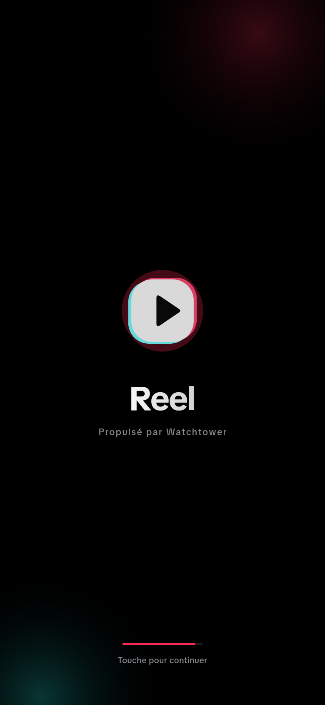 |
| Chargement | Même écran sans l'invite, tant que la config n'est pas lue | — |
| Transition | Fondu vers le feed, déclenché par un tap ou par la fin du chargement | — |

## 2. Feed vertical — « Pour toi » et « Suivis »

**Rôle** : cœur de l'application. Un flux plein écran, une vidéo à la fois, qui
défile verticalement. En haut : accès au direct, onglets **Suivis / Pour toi**,
recherche et coupure du son. À droite : avatar du créateur, cœur, commentaires,
enregistrement et partage, avec les compteurs **toujours visibles sous chaque
icône**. En bas : titre, description, hashtags, son, invite « Glisse vers le
haut ». Barre de navigation : Accueil, Amis, Créer, Boîte, Profil.

**États**

| État | Description | Capture |
|------|-------------|---------|
| Pour toi | Flux alimenté par la source active | 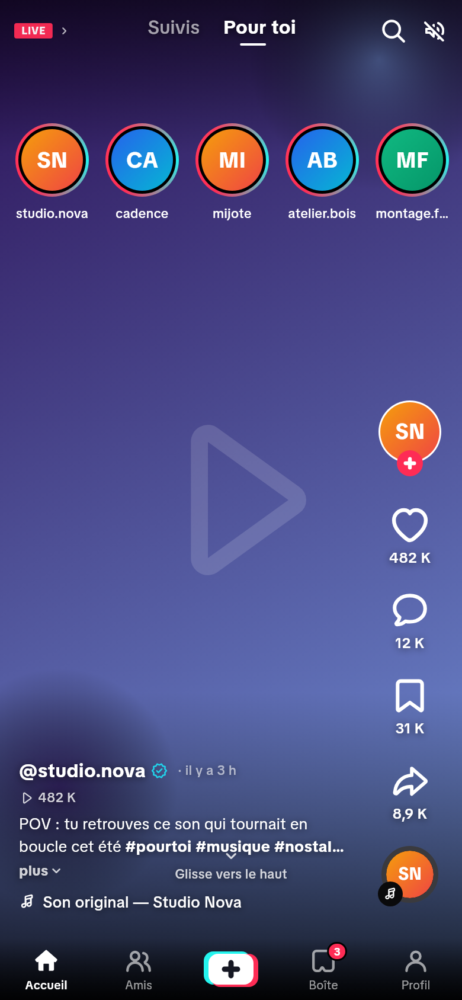 |
| Suivis (vide) | Aucun créateur suivi : explication + bouton « Explorer « Pour toi » » | 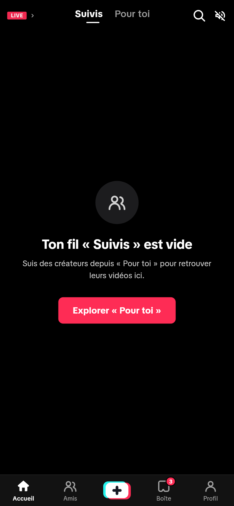 |
| Chargement | Squelette animé (blocs de texte et rail d'actions) | 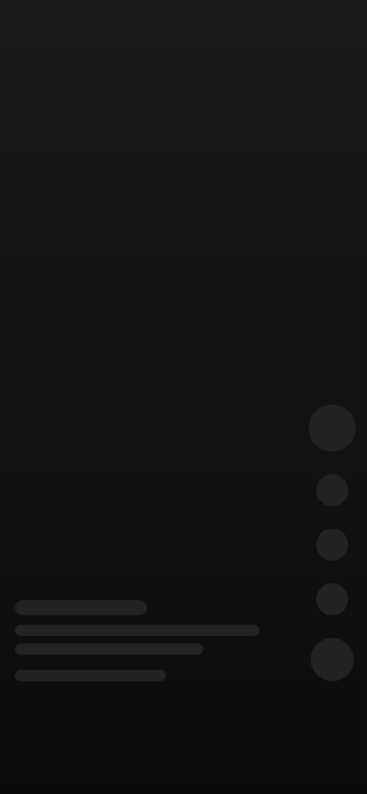 |
| Erreur | Message « Impossible de charger le feed », boutons Réessayer / Serveur | 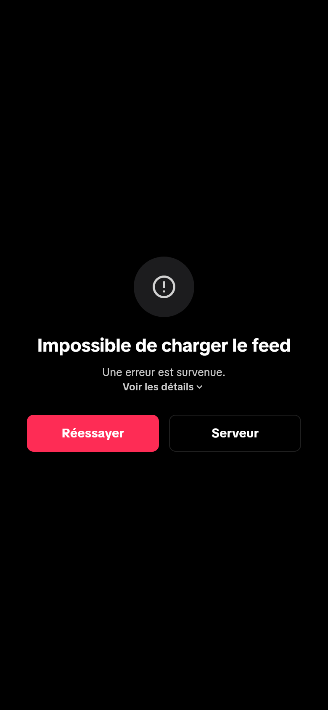 |
| Vide / non configuré | « Aucun contenu disponible », boutons Configurer / Actualiser | 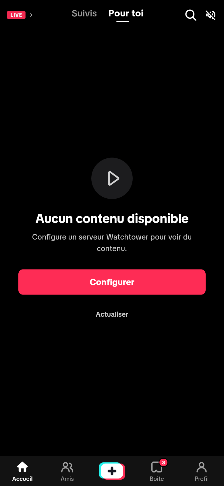 |
| Pause | Un tap met la vidéo en pause : grande icône lecture au centre | 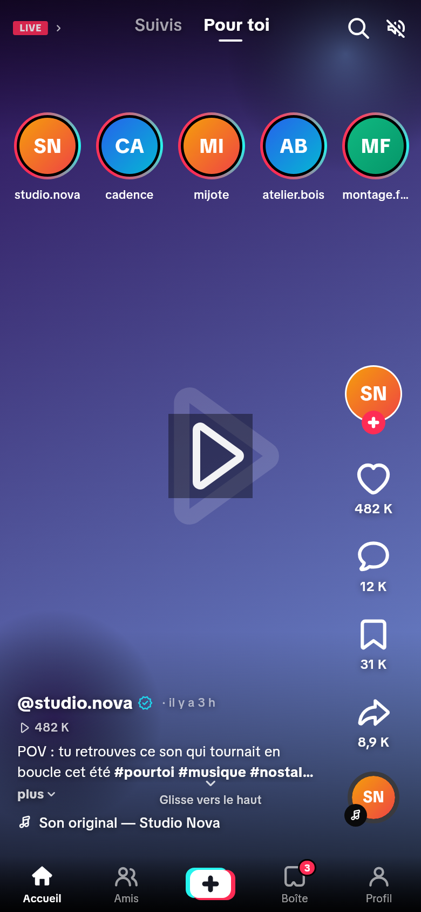 |

Autres états non capturés : fin de flux (« Glisse vers le haut » relance le
chargement), mode muet (`feedMutedProvider`), vidéo masquée après « Pas
intéressé », survol de la barre de progression.

## 3. Panneau de commentaires

**Rôle** : lire, trier, aimer et publier des commentaires sans quitter le feed.
L'en-tête affiche le nombre total de commentaires (format court : `12 K`) et le
nombre de commentaires locaux. Le tri bascule entre « Pertinence » et « Récents ».
En bas : rangée d'emoji et champ « Ajouter un commentaire… ».

**États**

| État | Description | Capture |
|------|-------------|---------|
| Avec commentaires | Trois commentaires locaux, actions Répondre / Supprimer | 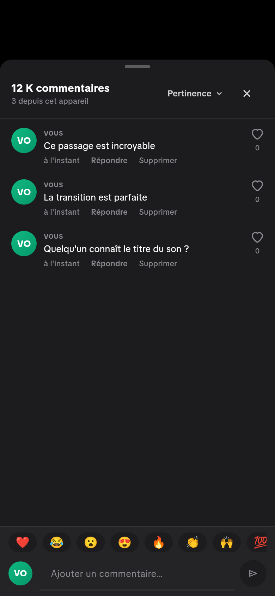 |
| Vide | « Sois la première personne à commenter » | 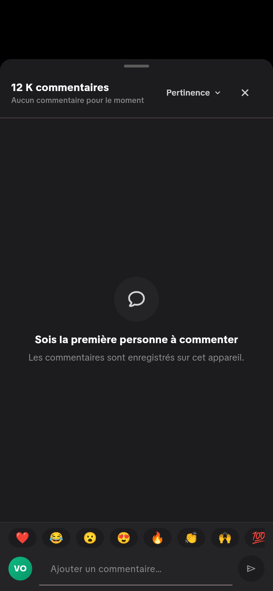 |

Autres états : tri « Récents » (bouton d'en-tête), ajout d'emoji dans le champ,
commentaire en cours de saisie (clavier ouvert).

## 4. Panneau de partage

**Rôle** : partager la vidéo courante — copier le lien, copier le texte,
enregistrer, « Plus tard », voir le son, pas intéressé, signaler, voir le profil.

**États**

| État | Description | Capture |
|------|-------------|---------|
| Par défaut | Lien `reel://…` + huit actions | 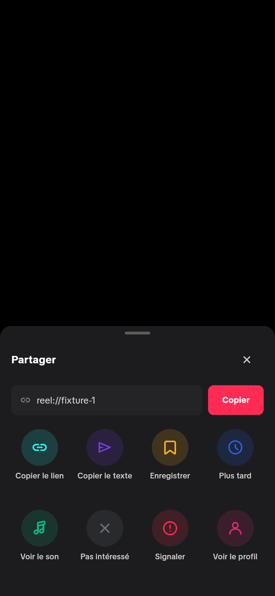 |

Autres états : confirmation « Lien copié » (toast), vidéo déjà enregistrée.

## 5. Panneau de création

**Rôle** : point d'entrée de publication (Caméra, Importer, Direct, Effets).
Dans Reel, la publication reste déléguée à la source active : le panneau
explique « Publier une vidéo depuis Reel ».

**États**

| État | Description | Capture |
|------|-------------|---------|
| Par défaut | Quatre raccourcis de création | 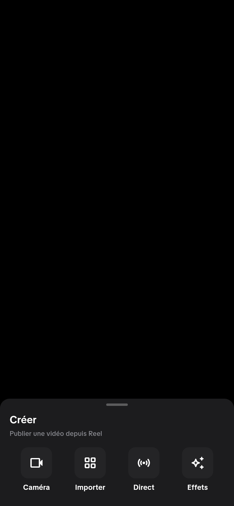 |

## 6. Panneau « Plus d'options » d'une vidéo

**Rôle** : fiche compacte d'une vidéo ouverte depuis la recherche ou le profil
(vignette, créateur, description, compteurs) avec les actions Commenter,
Partager et Enregistrer.

**États**

| État | Description | Capture |
|------|-------------|---------|
| Par défaut | Vignette + description + trois actions | 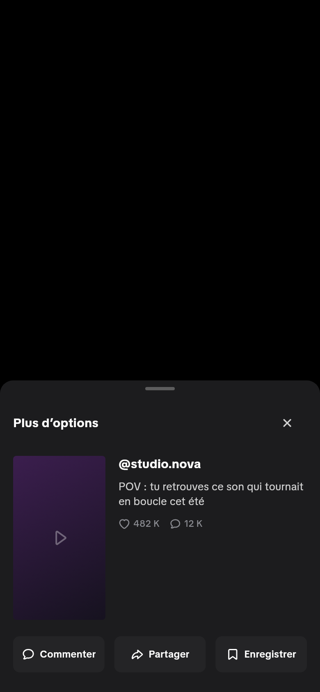 |

Autres états : vidéo enregistrée (icône active, libellé « Enregistré »).

## 7. Animation « J'aime »

**Rôle** : retour visuel au double-tap sur la vidéo (cœur qui apparaît, grossit
et disparaît) et au tap sur le cœur du rail d'actions.

**États**

| État | Description | Capture |
|------|-------------|---------|
| Double-tap | Cœur plein au centre de la vidéo |  |

## 8. Recherche et découverte

**Rôle** : rechercher des vidéos, créateurs et hashtags dans la source active.
Tant que la requête est vide, l'écran propose les créateurs du feed et les
tendances (hashtags avec nombre de vidéos et flèche de tendance).

**États**

| État | Description | Capture |
|------|-------------|---------|
| Découverte | Champ de recherche, créateurs du feed, tendances | 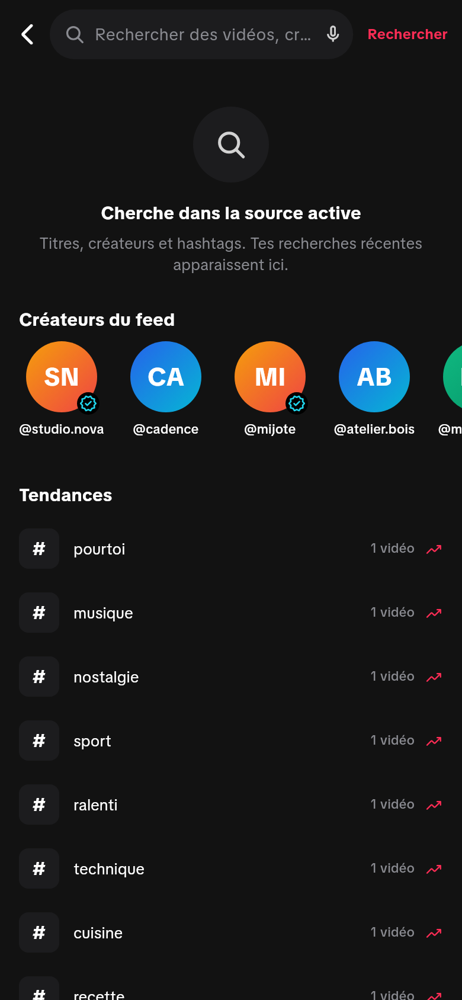 |
| Historique | Recherches récentes (stockées localement) | — |

## 9. Résultats de recherche

**Rôle** : résultats classés par onglets — **Top, Utilisateurs, Vidéos, Sons,
Hashtags** — avec le nombre de résultats et un accès aux filtres de tri.

**États**

| État | Description | Capture |
|------|-------------|---------|
| Résultats | Créateurs puis vidéos populaires pour « son » | 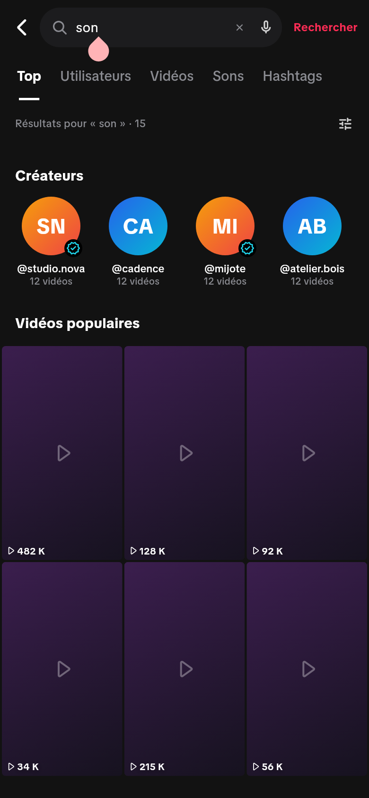 |
| Aucun résultat | « Aucun résultat pour « zzzz » » + conseil | 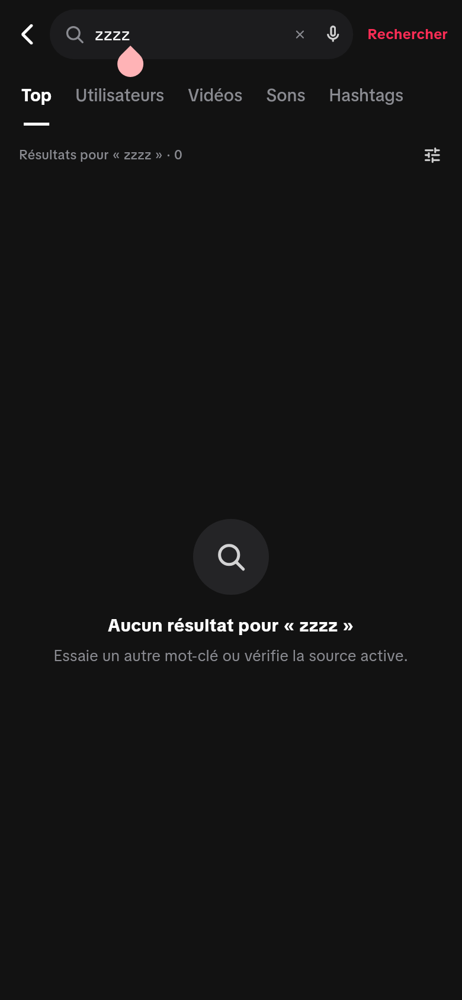 |
| Onglets | Bascule Utilisateurs / Vidéos / Sons / Hashtags | — |

## 10. Filtres de tri des résultats

**Rôle** : choisir l'ordre des résultats — Pertinence, Popularité, Récence — et
réinitialiser.

**États**

| État | Description | Capture |
|------|-------------|---------|
| Ouvert | Pertinence sélectionnée, options listées | 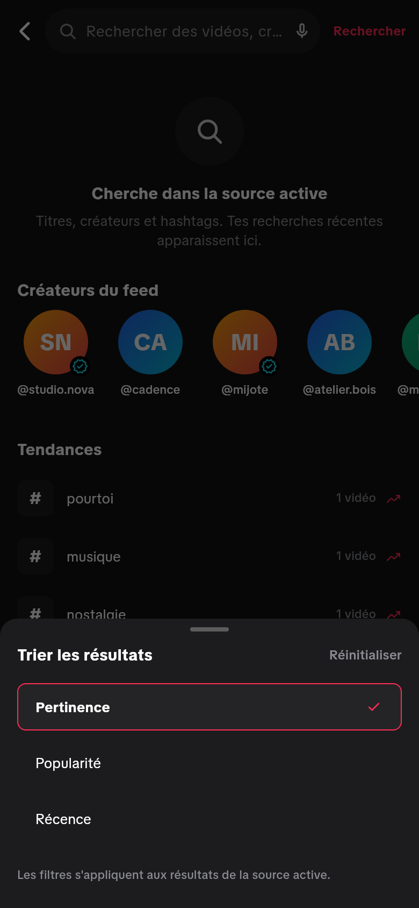 |

## 11. Profil

**Rôle** : profil local de l'utilisateur — avatar, pseudo, bio, statistiques
(Abonnements, Abonnés, J'aime), bouton « Modifier le profil », partage du profil,
accès aux paramètres, puis trois onglets : **Vidéos**, **Favoris**, **J'aime**.

**États**

| État | Description | Capture |
|------|-------------|---------|
| Vidéos | Grille des vidéos vues/publiées (6 dans la démo) | 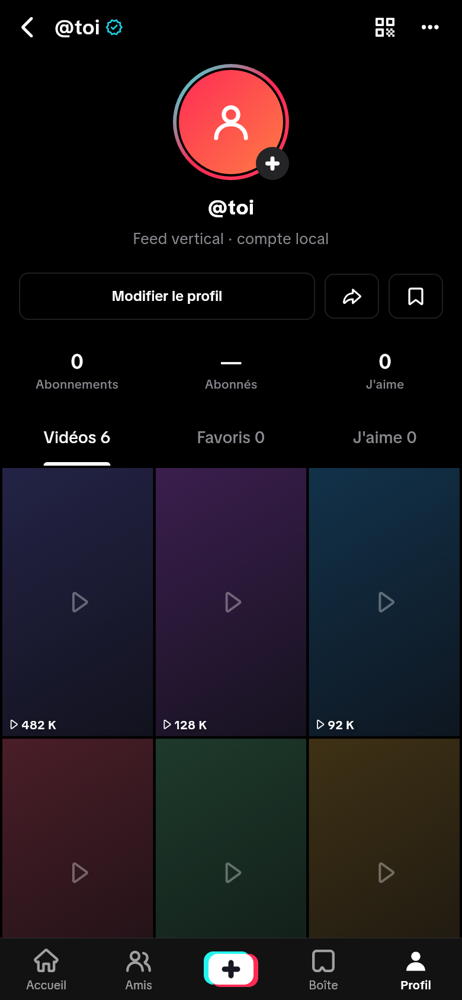 |
| Favoris (vide) | « Aucun favori — Enregistre une vidéo avec le signet » | 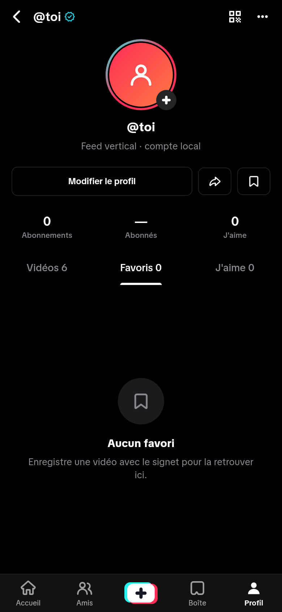 |
| J'aime | Grille des vidéos aimées | — |

## 12. Modification du profil

**Rôle** : éditer le nom, la bio et le lien du profil local. Les modifications
restent sur l'appareil.

**États**

| État | Description | Capture |
|------|-------------|---------|
| Ouvert | Champs Nom (0/24), Bio (0/80), Lien (0/120) + bouton Enregistrer | 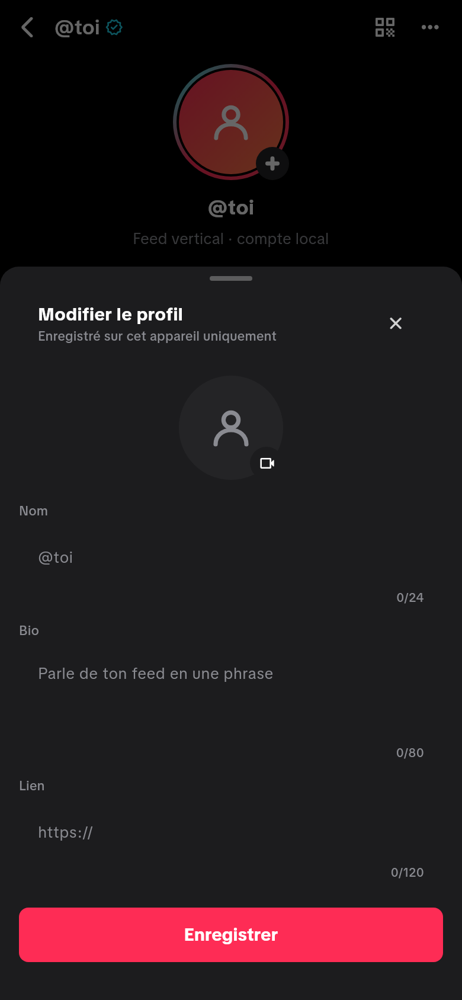 |
| Saisie | Compteurs de caractères actifs, bouton activé | — |

## 13. Page créateur

**Rôle** : page publique d'un créateur depuis le feed ou la recherche — avatar,
pseudo, statistiques (Vidéos, J'aime), bouton Suivre, puis ses vidéos.

**États**

| État | Description | Capture |
|------|-------------|---------|
| Avec vidéos | Un créateur du feed et sa vidéo | 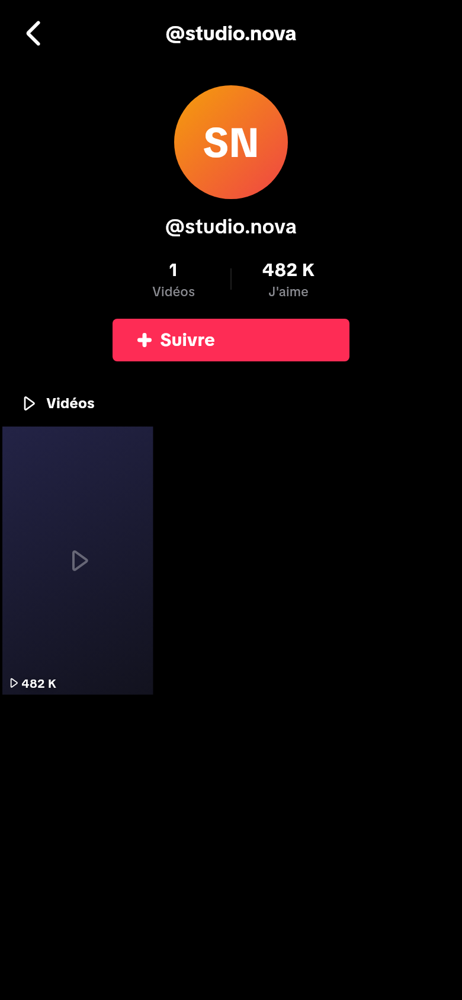 |
| Sans vidéo | Créateur inconnu : « Aucune vidéo chargée » | 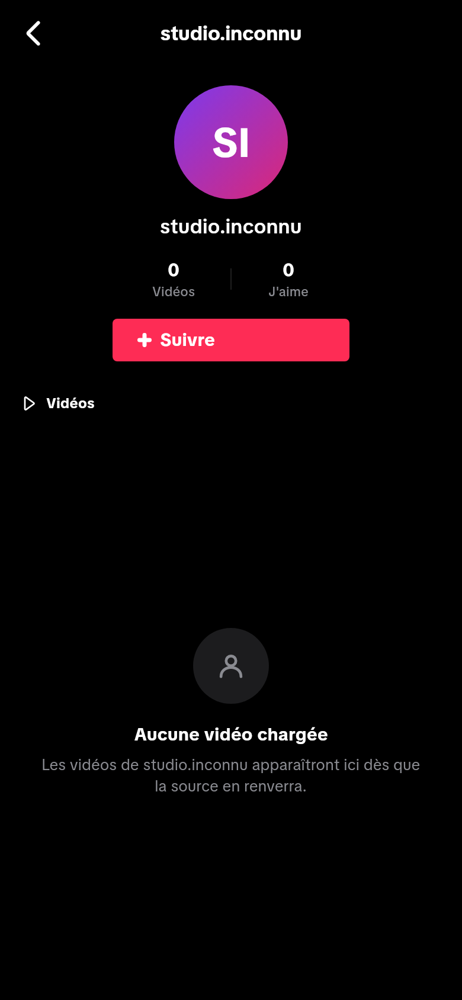 |
| Déjà suivi | Bouton « Suivi » au lieu de « Suivre » | — |

## 14. Amis

**Rôle** : retrouver les créateurs suivis et en découvrir de nouveaux, avec une
recherche de créateur et deux onglets : **Suggestions** et **Abonnements**.

**États**

| État | Description | Capture |
|------|-------------|---------|
| Suggestions | Cartes de créateurs avec bouton Suivre | 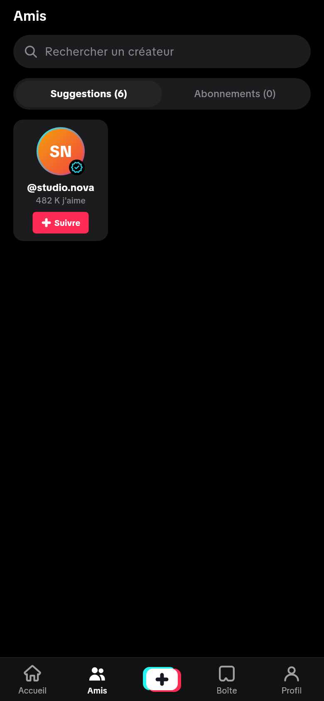 |
| Abonnements (vide) | Aucun abonnement pour le moment | — |
| Recherche | Filtrage des créateurs par nom | — |

## 15. Boîte de réception

**Rôle** : notifications et état du système. Trois onglets : **Tout**,
**Activité**, **Système**. La démo affiche une carte « État du serveur ».

**États**

| État | Description | Capture |
|------|-------------|---------|
| Avec activité | Carte d'état du serveur, point de notification | 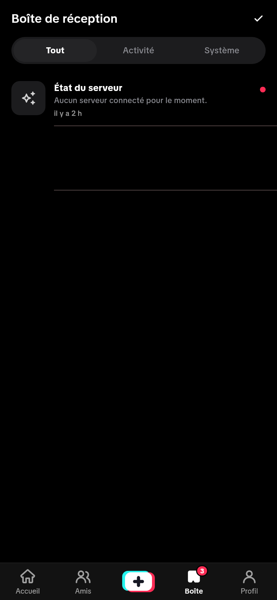 |
| Vide | « Aucune activité » par onglet | — |

## 16. Direct (LIVE)

**Rôle** : regrouper les créateurs en direct et les créateurs à suivre. Reel
n'expose pas encore de flux vidéo en direct : un bandeau l'explique et la page
sert de vitrine des créateurs du feed.

**États**

| État | Description | Capture |
|------|-------------|---------|
| Par défaut | Bandeau d'explication, grille « En direct maintenant », « Créateurs à suivre » | 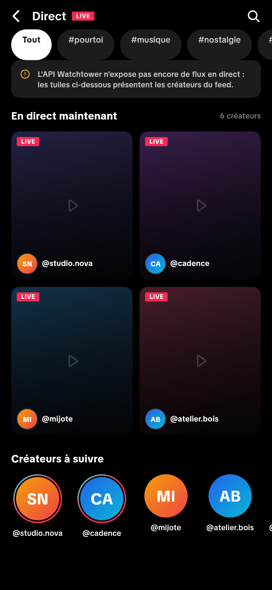 |
| Filtre hashtag | Puces `#pourtoi`, `#musique`, `#nostalgie`… | — |

## 17. Paramètres et confidentialité

**Rôle** : réglages du compte et de l'app — Gérer mon compte, Confidentialité,
Contenu masqué, Son du feed (lecture avec audio), Filtres de recherche,
Apparence (toujours sombre), Serveur Watchtower, Source active, Clé d'API,
Vider le cache d'images, Effacer mes données locales.

**États**

| État | Description | Capture |
|------|-------------|---------|
| Par défaut | Sections Compte / Contenu et affichage / Connexion / Stockage | 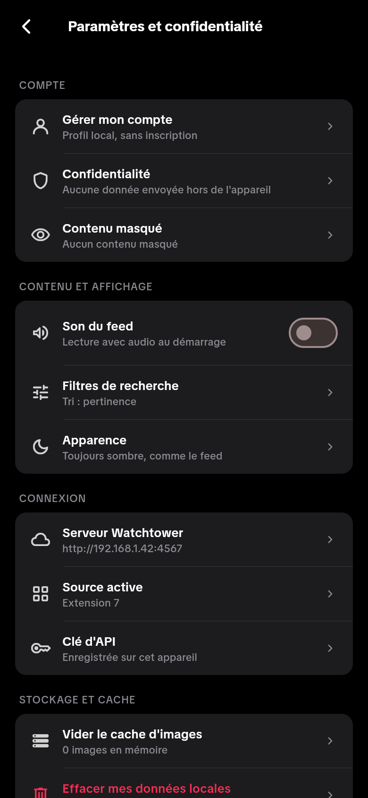 |
| Son du feed | Interrupteur audio activé/désactivé | — |

## 18. Serveur / Connexion

**Rôle** : connecter Reel à un serveur Watchtower — URL du serveur, clé API,
test de connexion, choix de la source par défaut, déconnexion.

**États**

| État | Description | Capture |
|------|-------------|---------|
| Non configuré | Carte « Connecte ton serveur Watchtower », champs vides | 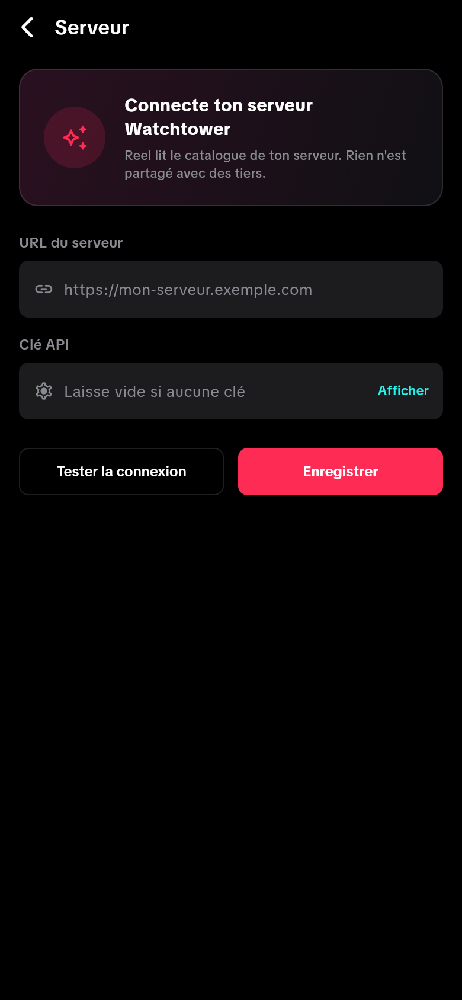 |
| Configuré et joignable | URL et clé préremplies, bandeau vert « Serveur joignable · 2 sources · version 1.9.4 », sélecteur de source | 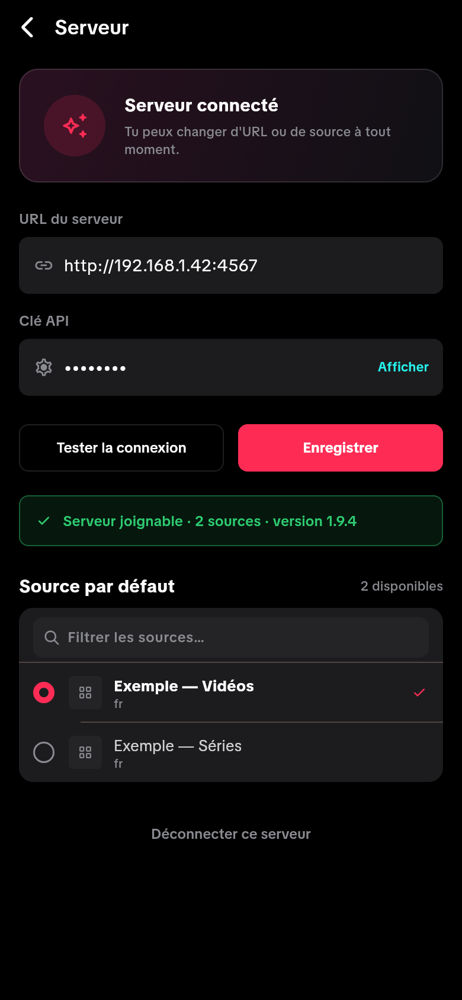 |
| Échec du test | Bandeau rouge « Connexion impossible (…) » avec le détail | — |
| Test en cours | Bouton « Test… » désactivé et indicateur de chargement | — |

---

## Ce que ces captures ne montrent pas

- **Vidéo réelle** : le harnais n'a pas de décodeur ; les vignettes sont des
  dégradés avec icône lecture, les compteurs et les textes sont réels.
- **Gestes** : le double-tap « J'aime » est capturé à son apogée, pas animé.
- **Clavier** : les champs texte sont capturés sans clavier virtuel.
- **Données distantes** : le catalogue provient de `fixtureFeedItems`, pas d'un
  serveur Watchtower en production.
